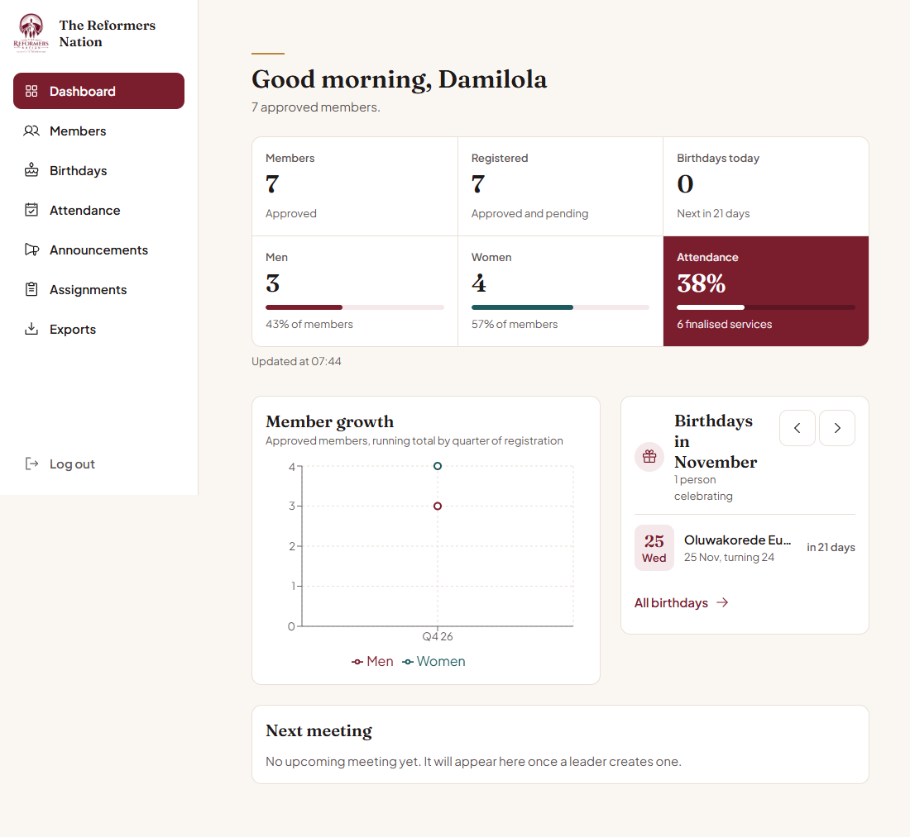
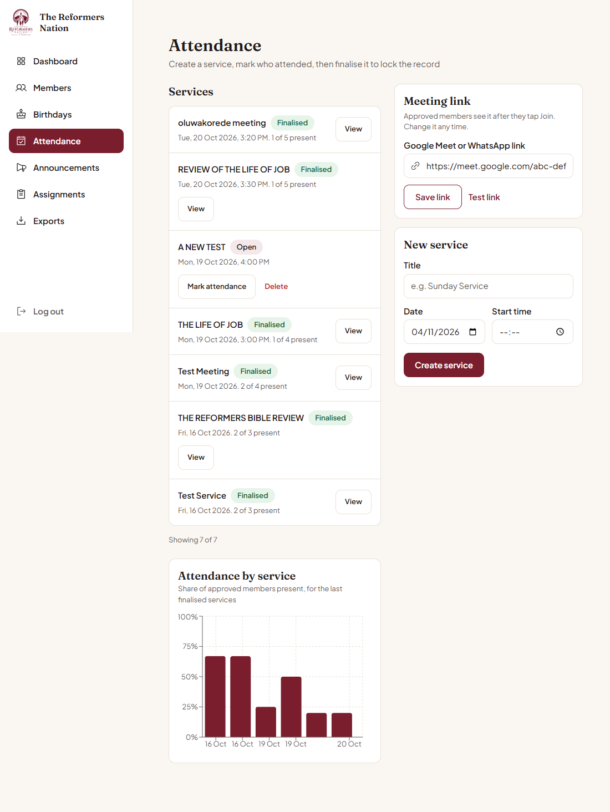
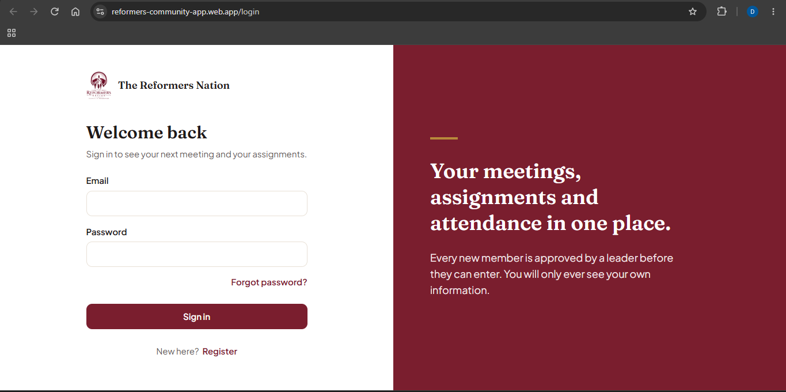
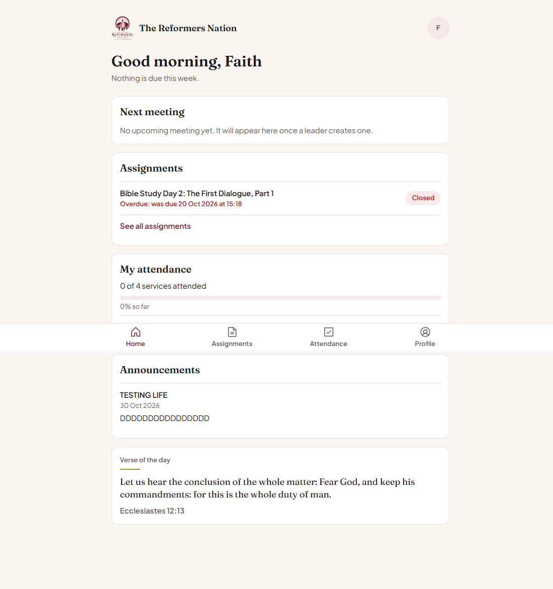

# Reformers Community App

A private community management platform that brings member records, announcements, assignments, meetings and attendance into one organised system.

**Live Application:** https://reformers-community-app.web.app/

## Overview

The Reformers Community App is a web-based platform designed to help community leaders manage their members and coordinate activities while giving individual members a secure space to access relevant community information.

The platform provides two separate experiences:

- **Admin Dashboard:** Gives administrators centralised access to member management, attendance, announcements, assignments, meetings and community reports.
- **Member Dashboard:** Allows approved members to view announcements, access assignments, submit responses, join meetings and manage their personal information.

The application was built to reduce dependence on scattered communication channels, manual attendance records and disconnected administrative tools.

## Application Screenshots

### Admin Dashboard


### Attendance Management


### Login Page


### Member Dashboard

## Key Features

### 1. Administrator Dashboard

Administrators have access to a central dashboard for managing community activities and member information.

- Dashboard overview with member statistics and attendance information.
- View, search, approve and edit member records.
- Assign administrator roles.
- View member birthdays and upcoming celebrations.
- Create meetings and manage meeting links.
- Record, review and manage attendance.
- Create announcements and assignments.
- Review member assignment submissions and approval status.
- View member growth and attendance trends.
- Export member and attendance records to Excel and PDF.

### 2. Member Dashboard

Approved members have access to a personalised dashboard containing information relevant to them.

- View community announcements.
- Access assignments and deadlines.
- Submit assignment responses.
- Track assignment approval status.
- View upcoming meetings and join through the provided meeting link.
- Record attendance when joining meetings.
- View personal attendance information.
- Access and manage their own profile.

### 3. Authentication and Access Control

The application uses separate access permissions for administrators and regular members.

- Member registration through an invitation or registration link.
- New accounts require administrator approval before accessing the platform.
- Role-based access control separates administrator and member experiences.
- Members can only access their own profile and personal information.
- Administrators have authorised access to community-wide member records.
- Meeting links and other restricted information are available only to approved members.

## Technology Stack

- **Frontend:** React, TypeScript
- **Styling:** Tailwind CSS
- **Backend Services:** Firebase
- **Authentication:** Firebase Authentication
- **Database:** Cloud Firestore
- **Storage:** Firebase Storage

## Application Structure

The platform is organised around two main user roles:

| Administrator | Member |
|---|---|
| Manage all member records | View personal profile |
| Approve new registrations | View announcements |
| Assign administrator roles | Access assignments |
| Manage meetings | Submit assignments |
| Record and review attendance | Join meetings |
| Review submissions | View personal attendance |
| View reports and statistics | Access approved community information |

## Privacy and Data Access

Member privacy is an important part of the application design.

- Members cannot view other members' profiles.
- Administrators have access to community-wide member information.
- Pending registrations cannot access the member dashboard.
- Only approved members can access restricted community information.
- Administrative actions are restricted to authorised administrators.

## Project Status

The application has been developed and deployed for use by **The Reformers Nation**, its first community.

The current version supports community administration and member participation through separate dashboards.

A future development stage will explore expanding the application into a multi-community platform, allowing multiple communities to operate independently with their own branding and member records.

## Live Demo

[Visit the Reformers Community App](https://reformers-community-app.web.app/)

## Local Development

To run the project locally:

1. Clone the repository:

   ```bash
   git clone https://github.com/Damilola-Dev1/reformers-community-app.git
   ```

2. Navigate into the project directory:

   ```bash
   cd reformers-community-app
   ```

3. Install dependencies:

   ```bash
   npm install
   ```

4. Configure the required Firebase environment variables.

5. Start the development server:

   ```bash
   npm run dev
   ```

## Developer

Damilola Samuel A.

Frontend Developer

- [GitHub](https://github.com/Damilola-Dev1)
- [Live Application](https://reformers-community-app.web.app/)
